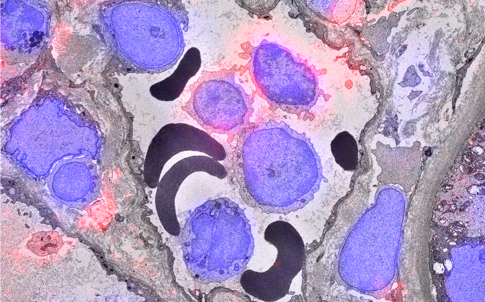
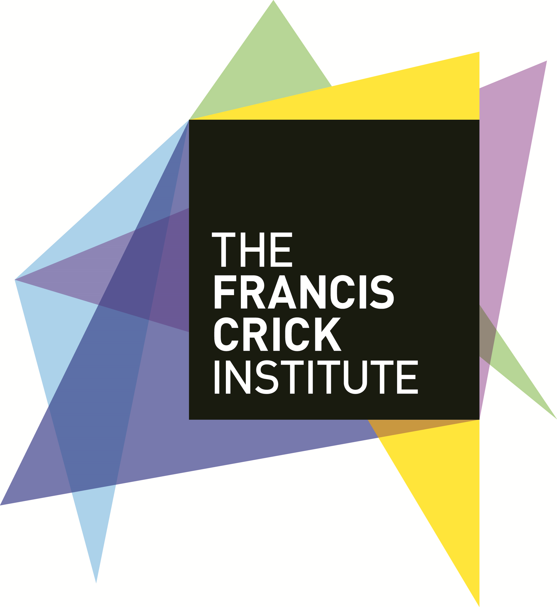
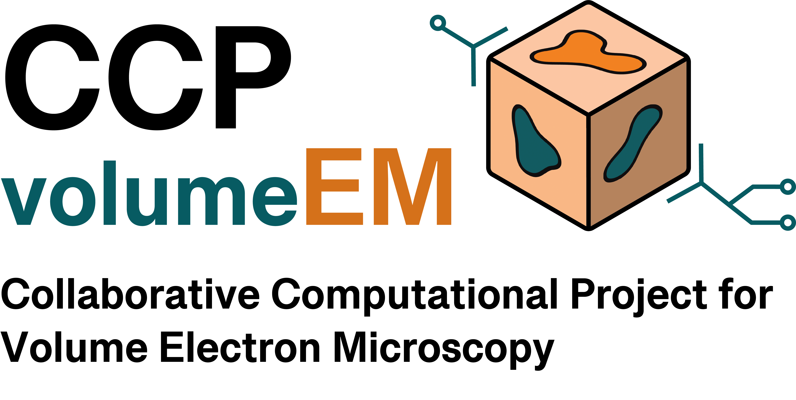

# Image analysis for Correlative Light and Electron Microscopy (CLEM)

#### 30th November 2026 - 4th December, Francis Crick Institute

# Overview

This five-day course, aimed at researchers and core facility staff, focuses on enhancing participants’ skills in image analysis for Correlative Light and Electron Microscopy (CLEM) using open-source software and publicly available datasets. This course is run in collaboration with the Collaborative Computational Project (CCP) for Volume Electron Microscopy ([CCP-volumeEM](https://www.ccp-volumeem.ac.uk/))

# Registration

Registration to this workshop has now closed.

# Instructors
* [Cameron Shand, Francis Crick Institute](https://www.crick.ac.uk/research/find-a-researcher/cameron-shand)
* [Candice Roufosse, Imperial College London](https://profiles.imperial.ac.uk/c.roufosse)
* [Daniel Krentzel, Universitat Zurich](https://www.mls.uzh.ch/en/research/uhlmann/groupmembers.html)
* [Mariam Demir, STFC Scientific Computing](https://www.sc.stfc.ac.uk/team/)
* [Martin Jones, Francis Crick Institute](https://www.crick.ac.uk/research/find-a-researcher/martin-jones)
* [Matthew Hartley, EMBL EBI](https://www.ebi.ac.uk/people/person/matthew-hartley/)
* [Sara Salgueiro Torres, Francis Crick Institute](https://www.crick.ac.uk/research/find-a-researcher/sara-salgueiro-torres)
* [Stefania Marcotti, Francis Crick Institute](https://www.linkedin.com/in/stefania-marcotti/)

# Preparation

1. Please remember to bring your laptop (and charger). A computer mouse will also be helpful.
2. Ensure your laptop can connect to WiFi networks outside your host institute ([eduroam](https://eduroam.org/) would be ideal) - check with your local IT support team if you're not sure.
3. Please install the required software before the workshop - follow the installation instructions on [this page](./Pages/installation_instructions.md).
4. Download the workshop data by clicking on the link to the ZIP archive at the top of this page.
6. **PLEASE CONTACT US BEFORE THE WORKSHOP IF YOU ENCOUNTER ANY DIFFICULTIES WITH ANY OF THE ABOVE.**

# Program

<table style="width:100%">
	<tbody>
		<tr>
			<th colspan=3>Monday, November 30th 2026</th>
		</tr>
		<tr>
			<td>09:00 - 09:15</td>
			<td colspan=2>Registrations</td>
		</tr>
		<tr>
			<td>09:15 - 09:30</td>
			<td colspan=2>Welcome to the course</td>
		</tr>
		<tr>
			<td>09:30 - 11:00</td>
			<td>Session 1</td>
			<td>
Introduction & Installations
</td>
		</tr>
		<tr>
			<td></td>
			<td colspan=3>
				<ul>
					<li>Martin Jones and Stefania Marcotti</li>
					<ul><li>Who are you and why are you here?</li></ul>
					<ul><li>What are we going to cover in the course?</li></ul>
					<ul><li>Introduction to the virtual machines</li></ul>
				</ul>
			</td>
		</tr>
		<tr>
			<td>11:00 - 11:15</td>
			<td colspan=2>Coffee Break</td>
		</tr>
		<tr>
			<td>11:15 - 12:45</td>
			<td>Session 2</td>
			<td>
Introduction to image analysis
</td>
		</tr>
		<tr>
			<td></td>
			<td colspan=3>
				<ul>
					<li>Sara Salgueiro Torres</li>
					<ul>
						<li>Foundational concepts</li>
						<li>Traditional vs. machine learning approaches</li>
						<li>Metadata and scientific reproducibility</li>
					</ul>
				</ul>
			</td>
		</tr>
		<tr>
			<td>12:45 - 13:45</td>
			<td colspan=2>Lunch</td>
		</tr>
		<tr>
			<td>13:45 - 15:15</td> 
			<td>Session 3</td>
			<td>
Building an analysis pipeline for light microscopy data
</td>
		</tr>
		<tr>
			<td></td>
			<td colspan=3>
			<ul>
				<li>Sara Salgueiro Torres and Stefania Marcotti</li>
				<ul>
					<li>Counting and quantifying morphology of objects using Fiji</li>
					<li>Quantifying fluorescence intensities using Fiji</li>
				</ul>
			</ul>
			</td>
		</tr>
		<tr>
			<td>15:15 - 15:30</td>
			<td colspan=2>Coffee Break</td>
		</tr>
		<tr>
			<td>15:30 - 17:00</td> 
			<td>Session 4</td>
			<td>
Building an analysis pipeline for light microscopy data
</td>
		</tr>
		<tr>
			<td></td>
			<td colspan=3>
			<ul>
				<li>Sara Salgueiro Torres and Stefania Marcotti</li>
				<ul>
					<li>Extending the analysis to 3 dimensions using Fiji</li>
				</ul>
			</ul>
			</td>
		</tr>
		<tr>
			<th colspan=3>Tuesday, December 1st 2026</th>
		</tr>
		<tr>
			<td>09:30 - 11:00</td>
			<td>Session 5</td>
			<td>
Building an analysis pipeline for light microscopy data
</td>
		</tr>
		<tr>
			<td></td>
			<td colspan=3>
				<ul>
				<li>Stefania Marcotti</li>
				<ul>
					<li>Segmenting objects using machine learning algorithms in ilastik</li>
					<li>Other machine learning approaches</li>
				</ul>
				</ul>
			</td>
		</tr>
		<tr>
			<td>11:00 - 11:15</td>
			<td colspan=2>Coffee Break</td>
		</tr>
		<tr>
			<td>11:15 - 12:45</td>
			<td>Session 6</td>
			<td>
Building an analysis pipeline for electron microscopy data
</td>
		</tr>
		<tr>
			<td></td>
			<td colspan=3>
				<ul>
				<li>Mariam Demir and Martin Jones</li>
				<ul>
					<li>Manual segmentation using Labkit</li>
					<li>Segmenting objects using machine learning algorithms in ilastik</li>
				</ul>
				</ul>
			</td>
		</tr>
		<tr>
			<td>12:45 - 13:45</td>
			<td colspan=2>Lunch</td>
		</tr>
		<tr>
			<td>13:45 - 15:15</td>
			<td>Session 7</td>
			<td>
Building an analysis pipeline for electron microscopy data
</td>
		</tr>
		<tr>
			<td></td>
			<td colspan=3>
				<ul>
				<li>Mariam Demir and Martin Jones</li>
				<ul>
					<li>Performing quantitative measurements</li>
				</ul>
				</ul>
			</td>
		</tr>
		<tr>
			<td>15:15 - 15:30</td>
			<td colspan=2>Coffee Break</td>
		</tr>
		<tr>
			<td>15:30 - 17:00</td>
			<td>Session 8</td>
			<td>
Data reuse
</td>
		</tr>
		<tr>
			<td></td>
			<td colspan=3>
				<ul>
				<li>Matthew Hartley</li>
				<ul>
					<li>Image repositories</li>
					<li>Using Next Generation File Formats (NGFFs)</li>
				</ul>
				</ul>
			</td>
		</tr>
		<tr>
			<th colspan=3>Wednesday, December 2nd 2026</th>
		</tr>
		<tr>
			<td>09:30 - 11:00</td>
			<td>Session 9</td>
			<td>
Designing scalable pipelines
</td>
		</tr>
		<tr>
			<td></td>
			<td colspan=3>
				<ul>
				<li>Cameron Shand and Martin Jones</li>
				<ul>
					<li>Implementing machine learning segmentation with AI OnDemand</li>
					<li>Introducing containers</li>
				</ul>
				</ul>
			</td>
		</tr>
		<tr>
			<td>11:00 - 11:15</td>
			<td colspan=2>Coffee Break</td>
		</tr>
		<tr>
			<td>11:15 - 12:45</td>
			<td>Session 10</td>
			<td>
Reconstructing image volumes
</td>
		</tr>
		<tr>
			<td></td>
			<td colspan=3>
				<ul>
				<li>Cameron Shand and Martin Jones</li>
				<ul>
					<li>Opening and cropping images</li>
					<li>Visualising image volumes</li>	
				</ul>
				</ul>
			</td>
		</tr>
		<tr>
			<td>12:45 - 13:45</td>
			<td colspan=2>Lunch</td>
		</tr>
		<tr>
			<td>13:45 - 15:15</td>
			<td>Session 11</td>
			<td>
Reconstructing image volumes
</td>
		</tr>
		<tr>
			<td></td>
			<td colspan=3>
				<ul>
				<li>Mariam Demir and Martin Jones</li>
				<ul>
					<li>Stitching image volumes</li>
				</ul>
				</ul>
			</td>
		</tr>
		<tr>
			<td>15:15 - 15:30</td>
			<td colspan=2>Coffee Break</td>
		</tr>
		<tr>
			<td>15:30 - 17:00</td>
			<td>Session 12</td>
			<td>
Correlating image volumes across modalities
</td>
		</tr>
		<tr>
			<td></td>
			<td colspan=3>
				<ul>
				<li>Daniel Krentzel</li>
				<ul>
					<li>Image volume registration using CLEM-Reg</li>
				</ul>
				</ul>
			</td>
		</tr>
		<tr>
			<th colspan=3>Thursday, December 3rd 2026</th>
		</tr>
		<tr>
			<td>09:30 - 11:00</td>
			<td>Session 13</td>
			<td>
Data reuse
</td>
		</tr>
		<tr>
			<td></td>
			<td colspan=3>
				<ul>
				<li>Candice Roufosse</li>
				<ul>
					<li>The science behind the course dataset</li>
					<li>Alternative biological questions</li>
				</ul>
				</ul>
			</td>
		</tr>
		<tr>
			<td>11:00 - 11:15</td>
			<td colspan=2>Coffee Break</td>
		</tr>
		<tr>
			<td>11:15 - 12:45</td>
			<td>Session 14</td>
			<td>
Group work
</td>
		</tr>
		<tr>
			<td>12:45 - 13:45</td>
			<td colspan=2>Lunch</td>
		</tr>
		<tr>
			<td>13:45 - 15:15</td>
			<td>Session 15</td>
			<td>
Group work
</td>
		</tr>
		<tr>
			<td>15:15 - 15:30</td>
			<td colspan=2>Coffee Break</td>
		</tr>
		<tr>
			<td>15:30 - 17:00</td>
			<td>Session 16</td>
			<td>
Group work
</td>
		</tr>
		<tr>
			<th colspan=3>Friday, December 4th 2026</th>
		</tr>
		<tr>
			<td>09:30 - 11:00</td>
			<td>Session 17</td>
			<td>
Group work
</td>
		</tr>
		<tr>
			<td>11:00 - 11:15</td>
			<td colspan=2>Coffee Break</td>
		</tr>
		<tr>
			<td>11:15 - 12:45</td>
			<td>Session 18</td>
			<td>
Group work
</td>
		</tr>
		<tr>
			<td>12:45 - 13:45</td>
			<td colspan=2>Lunch</td>
		</tr>
		<tr>
			<td>13:45 - 15:15</td>
			<td>Session 19</td>
			<td>
Final presentations from attendees
</td>
		</tr>
		<tr>
			<td>15:15 - 15:30</td>
			<td colspan=2>Coffee Break</td>
		</tr>
		<tr>
			<td>15:30 - 17:00</td>
			<td>Session 20</td>
			<td>
Q&A and closing remarks
</td>
		</tr>
	</tbody>
</table>

# Venue

The workshop will take place in the Francis Crick Institute, London, UK.

	  

